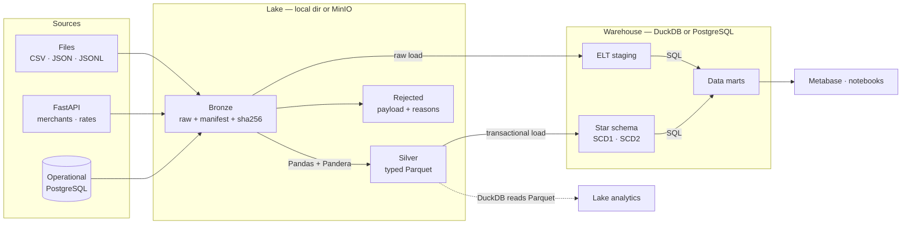

# FinFlow — financial data engineering, end to end, on a laptop

FinFlow is a local, reproducible reference implementation of a batch data
platform for a **fictional** bank. Synthetic data from three kinds of
operational sources lands in an immutable raw layer, is validated and
conformed into Parquet, loads into a dimensional warehouse, and is served
through data marts, SQL, notebooks and dashboards.

All data is synthetic and generated locally. No real institution, customer
or dataset is involved, and the simulated "risk rules" are not a fraud model.

## Project status

Personal learning and portfolio project, developed with AI assistance
(Claude Code) and reviewed by the repository owner. **Not production-ready.**

- **Lightweight profile** (Python + DuckDB, no Docker): implemented and
  verified — 102 automated tests pass, coverage 91%.
- **Data and full profiles** (PostgreSQL, MinIO, FastAPI, Airflow, Metabase):
  implemented and verified locally — service tests pass, Airflow DAG runs
  (including a rehearsed failure and recovery) succeed, Metabase dashboard built.
- **CI workflow and pre-commit hooks**: configured, not yet run.

Details: [docs/implementation-status.md](docs/implementation-status.md).

## Motivation

I have built APIs, relational databases and containerised systems as a
full-stack developer. Data engineering asks different questions: what happens
when the same file arrives twice, when a record references a customer that
does not exist yet, when a load fails halfway, or when two teams compute
"total value" differently. FinFlow is where I work through those questions
in code I can run, break and explain — small enough to understand completely,
complete enough to discuss seriously.

## Business problem

The fictional bank receives daily exports from independent systems: core
banking (customers, accounts), cards, lending (loans, payments), a merchant
registry, treasury (exchange rates) and the transaction processor. Each has
its own format and its own data quality problems. The bank needs one
trustworthy place to answer questions such as:

- What is the daily transaction volume and value, and what share fails?
- Which merchant categories and currencies drive volume?
- Which customers are most active, and how does activity change over time?
- What is the volume of loan repayments, and how many are late or missed?
- How many records are rejected during ingestion, and by which rules?
- How long does each pipeline step take?

## Learning and engineering objectives

Python and Pandas for data processing; intermediate and advanced SQL; ETL and
ELT; data quality and validation; dimensional modelling and SCD2; lake
layering with Parquet; incremental and idempotent processing; orchestration;
analytical engines; and the software practices that keep all of it testable.
A 16-module [learning path](docs/learning/00-start-here.md) maps each topic
to the code.

## Scope

In scope: batch processing of small synthetic datasets (2,000–10,000
transactions per profile), three execution profiles, complete documentation.

Out of scope, on purpose: streaming, distributed processing (Spark, Kafka),
Kubernetes, cloud deployment (a [theoretical GCP mapping](docs/learning/14-cloud-architecture-concepts.md)
is provided instead), and any claim about production scale.

## Architecture



| Profile | Lake | Warehouse | Sources | Orchestration | Command |
|---|---|---|---|---|---|
| Lightweight (default) | `data/lake/` | DuckDB | files | CLI | `make demo` |
| Data engineering | MinIO | PostgreSQL 17 | files + API + PostgreSQL | CLI | `make up-data && make demo-data` |
| Full platform | MinIO | PostgreSQL 17 | same | Airflow 3 | `make up-full` |

One Python package serves all three; only three adapter functions differ
([overview](docs/architecture/overview.md)).

## Data lifecycle

1. **Generate** — deterministic synthetic exports per batch (`data/landing/<batch_id>/`), with ~5% intentionally broken transactions.
2. **Ingest → Bronze** — original bytes, manifest, checksum; write-once.
3. **Validate** — schema, parsing, Pandera rules, duplicates, references; quality gate.
4. **Transform → Silver** — typed Parquet, partitioned by date, with lineage columns; rejects to quarantine with their payload.
5. **Load → Gold** — one transaction: dimensions (SCD1/SCD2), facts with point-in-time keys, reconciliation, quality facts, watermarks.
6. **ELT** — raw rows into the warehouse, SQL typing/validation/dedup, incremental.
7. **Consume** — marts, DuckDB on Parquet, notebooks, Metabase.

## Technology stack

| Technology | Why |
|---|---|
| Python 3.12, uv | Airflow-compatible Python; locked, reproducible environments |
| Pandas 3, PyArrow | batch transforms with nullable dtypes; Parquet I/O and the filesystem abstraction |
| Pandera | declarative validation whose failure cases map to per-record rejection reasons |
| DuckDB | embedded analytical engine: lightweight warehouse and direct Parquet queries |
| PostgreSQL 17 | operational source and relational warehouse (MVCC, partial indexes, materialized views) |
| SQLAlchemy 2, psycopg 3 | database access with bound parameters |
| MinIO | S3-compatible object storage for the lake |
| FastAPI, httpx | REST source simulator and a client with pagination and retries |
| Faker | realistic synthetic names and places, seeded |
| Apache Airflow 3 | scheduling, retries, backfills; calls the CLI |
| Metabase | dashboards over the marts, read-only database role |
| Jupyter | exploration notebooks |
| pytest, ruff, mypy, pre-commit, gitleaks, GitHub Actions | quality gates |

Versions and the reasoning behind them: [ADR 0009](docs/adr/0009-dependency-pinning.md).

## Data sources

| Source type | Entities | Notes |
|---|---|---|
| Files (CSV, JSON, JSONL) | transactions, cards (+ everything in lightweight mode) | landing zone, one directory per batch |
| REST API (FastAPI) | merchants, exchange rates | paginated, time-window filters |
| Operational PostgreSQL | customers, accounts, loans, loan payments | extracted incrementally on `updated_at` |

Contracts for every entity: [docs/data-contracts/source-contracts.md](docs/data-contracts/source-contracts.md).

## Data modelling

A star schema with `fact_transactions` (grain: one row per transaction id),
`fact_loan_payments` (one row per installment), `fact_data_quality` and
`fact_pipeline_execution`; dimensions for date, currency, transaction type,
account, card, merchant, loan, and an SCD Type 2 `dim_customer`. Facts resolve
the customer version valid *at event time*. Money is always integer cents.
[Data model](docs/architecture/data-model.md) ·
[data dictionary](docs/data-contracts/data-dictionary.md).

## ETL and ELT

- **ETL** (`finflow etl`): Pandas/Pandera transform before loading; rich
  rejection reasons; one transaction per load. [ETL design](docs/architecture/etl-design.md)
- **ELT** (`finflow elt`): raw `VARCHAR` rows into the warehouse; SQL does
  typing, validation, deduplication and incremental merges — portable between
  DuckDB and PostgreSQL. [ELT design](docs/architecture/elt-design.md)

Both run on the same batches and are reconciled per day on count, failures
and value; they agree to the cent on the demo data.

## Data quality

Completeness, validity, uniqueness, referential integrity, consistency,
freshness and reconciliation rules; per-record quarantine; a gate that
refuses batches with more than 10% rejected records (exit code 2); and load
guards that roll back if any row is lost or attached to the wrong customer
version. [Data quality](docs/architecture/data-quality.md)

## Infrastructure requirements

| Profile | Minimum | Measured |
|---|---|---|
| Lightweight | 2 CPU, 2 GB RAM, ~1.5 GB disk (mostly the virtualenv) | demo: 7 s, 504–559 MiB peak RSS, 28.9 MB generated data |
| Data | 4 GB RAM, Docker | `make demo-data` 29.9 s; containers ~0.5 GB RAM |
| Full | 8 GB RAM, Docker, ~8 GB disk for images | ~2–2.8 GB RAM for all six containers (Metabase and Airflow ~1.1–1.3 GB each); images 7.3 GB |

## Quick start

```bash
git clone <repository-url> finflow-data-engineering && cd finflow-data-engineering
make setup      # uv sync --frozen, .env from .env.example, pre-commit hooks
make demo       # generate → ETL → idempotent rerun → ELT → marts → status
make test       # 102 tests, no Docker needed
```

Without Make: `uv sync --frozen && uv run finflow demo && uv run pytest -m "not services"`.

Docker profiles: [docs/runbooks/local-setup.md](docs/runbooks/local-setup.md).

## Example commands

```bash
uv run finflow generate --profile medium --force   # 5,000 transactions
uv run finflow generate-incremental                # one more business day
uv run finflow etl                                 # process pending batches
uv run finflow quality-report                      # rejection by batch and rule
uv run finflow analytics                           # DuckDB straight on Parquet
uv run finflow sql-examples --verbose              # 18 commented SQL examples
make demo-quality-gate                             # a batch the pipeline refuses
make demo-failure                                  # failure mid-load and recovery
make benchmark                                     # measured trade-offs
```

## Example analytical questions and results

From the default demo (seed 42, small profile + 2 incremental days):

| Question | Result |
|---|---|
| Transactions in the warehouse | 2,090 over 32 days |
| Share by currency | MXN 80.48%, USD 16.60%, EUR 1.58%, CAD 1.34% |
| Daily failure rate, first five days | 3.80%–6.67% |
| Records rejected at ingestion (historical batch) | 90 of 2,010 (4.48%), plus 10 duplicates |
| Most frequent rejection reason | `owner_mismatch` (20 records across 3 batches) |
| Customers with SCD2 history | 6 (106 versions for 100 customers) |
| Transactions flagged by simulated rules | 94 (75 foreign-at-night, 12 high-amount, 7 velocity) |
| ETL vs ELT disagreement | 0 days |

These numbers describe synthetic data generated to exercise the pipeline;
they carry no business meaning.

## Testing strategy

Unit tests for every rejection reason, money rounding, generator determinism
and retry policy; contract tests for source fields and Silver dtypes;
integration tests for the guarantees (idempotency, reconciliation, recovery,
late data, SCD2 correctness, ETL = ELT); CLI smoke tests; opt-in tests
against the Docker services that isolate themselves in throwaway databases
and buckets. [Testing](docs/testing.md)

## Security considerations

Synthetic data only; credentials only in an ignored `.env`; every port bound
to `127.0.0.1`; read-only role for BI; non-root, read-only app container;
secret scanning configured for pre-commit and CI. No TLS, static development
passwords, single-user Airflow — acceptable only because nothing leaves
localhost. [Security](docs/architecture/security.md)

## Architectural trade-offs

- **DuckDB and PostgreSQL share one SQL dialect subset** — portability over
  engine-specific features ([ADR 0001](docs/adr/0001-postgresql-warehouse-duckdb-lightweight.md)).
- **PostgreSQL as a warehouse** is a row store; fine at this size, the wrong
  choice at scale.
- **Pandas in memory** instead of Spark: correct for ≤ 10,000 rows per batch;
  measured peak 522 MiB for the large profile.
- **Plain Parquet** instead of Iceberg/Delta: simpler, but Silver rewrites are
  not atomic; immutable Bronze makes that recoverable.
- **Full mart rebuilds** instead of incremental models: milliseconds here,
  impossible to drift.
- **A community-built MinIO image**, because MinIO no longer publishes one
  ([ADR 0002](docs/adr/0002-minio-object-storage.md)).

## What was successfully implemented

All three profiles, verified locally: generator, three source types (files,
REST API, operational PostgreSQL), Bronze on disk and on MinIO, Silver,
quarantine, quality gate, star schema with SCD1/SCD2 on DuckDB and PostgreSQL,
transactional and idempotent loads, watermarks, late data and corrections,
failure recovery (CLI and Airflow), backfill, ELT with reconciliation, marts,
DuckDB lake analytics, SQL examples, benchmarks, Airflow DAGs, the Metabase
dashboard, CLI, documentation and the learning path.

## What was partially implemented

- CI and pre-commit are configured but have not run (no remote repository yet).
- Notebooks were executed cell by cell outside Jupyter, not in a kernel.
- The ELT path covers transactions only.

## What was not achieved

- Out-of-order SCD2 changes and a watermark look-back (documented limitations).
- Executing the notebooks as part of the test suite.

## Known limitations

- Small, synthetic data only; performance results do not extrapolate.
- `updated_at` watermarks miss back-dated source rows; SCD2 ignores changes
  older than the current version.
- The ELT path covers transactions only and accepts a stricter timestamp format than the ETL.
- Silver writes are not atomic across files.
- Development-grade security (no TLS, static credentials, simple auth).

## Future improvements

Iceberg/Delta for Silver, dbt for the ELT models, watermark look-back,
out-of-order SCD2, OpenLineage, metrics and alerting, image digests.
[Roadmap](docs/roadmap.md)

## Repository structure

```text
├── airflow/dags/            DAGs (call the CLI; no business logic)
├── config/finflow.toml      generation profiles, quality thresholds, risk rules, logging
├── dashboards/              Metabase questions (used by scripts/metabase_setup.py)
├── data/samples/            five records per source entity (generated data is not committed)
├── docs/                    architecture, ADRs, contracts, runbooks, learning path
├── infrastructure/          Dockerfiles, PostgreSQL init script
├── notebooks/               exploration notebooks (no outputs committed)
├── scripts/                 Metabase setup
├── sql/
│   ├── operational/         source database schema
│   ├── warehouse/           star schema DDL and load SQL (shared + *.postgres.sql)
│   ├── staging/             ELT staging and incremental SQL
│   ├── marts/               data marts
│   ├── quality/             ETL↔ELT reconciliation
│   └── examples/            18 commented, executable SQL examples
├── src/finflow/             the Python package
│   ├── common/              config, logging, money, storage, errors
│   ├── generators/          synthetic data
│   ├── sources/             files, FastAPI simulator + client, operational DB
│   ├── ingestion/           Bronze
│   ├── validation/          contracts, Pandera, quality gate
│   ├── transformations/     Silver, simulated risk rules
│   ├── warehouse/           DuckDB/PostgreSQL adapters, ELT
│   ├── orchestration/       ETL steps, batches, watermarks, metrics
│   ├── analytics/           lake queries, benchmarks, SQL example runner
│   └── cli/                 the `finflow` command
├── tests/                   unit, contracts, integration (+ opt-in services)
├── docker-compose.yml, Makefile, pyproject.toml, uv.lock
└── CHANGELOG.md, CONTRIBUTING.md, SECURITY.md, LICENSE
```

## Documentation index

| Topic | Document |
|---|---|
| Architecture | [overview](docs/architecture/overview.md) · [data flow](docs/architecture/data-flow.md) · [data model](docs/architecture/data-model.md) |
| Pipelines | [ETL](docs/architecture/etl-design.md) · [ELT](docs/architecture/elt-design.md) · [incremental processing](docs/architecture/incremental-processing.md) |
| Quality and security | [data quality](docs/architecture/data-quality.md) · [security](docs/architecture/security.md) |
| Contracts | [source contracts](docs/data-contracts/source-contracts.md) · [data dictionary](docs/data-contracts/data-dictionary.md) |
| Operations | [local setup](docs/runbooks/local-setup.md) · [pipeline execution](docs/runbooks/pipeline-execution.md) · [failure recovery](docs/runbooks/failure-recovery.md) · [troubleshooting](docs/runbooks/troubleshooting.md) |
| Engineering | [testing](docs/testing.md) · [performance](docs/performance.md) · [implementation status](docs/implementation-status.md) · [roadmap](docs/roadmap.md) |
| Decisions | [ADRs](docs/adr/README.md) |
| Learning path | [start here](docs/learning/00-start-here.md) |

## License

MIT — see [LICENSE](LICENSE). The copyright line is a placeholder for the
repository owner to complete.
