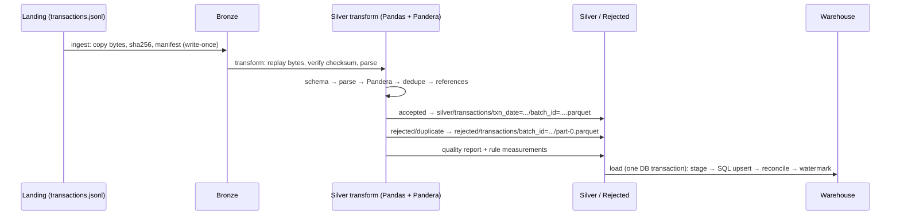

# Data flow

## Batches

Everything moves in **batches**. A batch is one export window of the simulated
operational systems, described by `data/landing/<batch_id>/_batch.json`:

| Field | Example | Meaning |
|---|---|---|
| `batch_id` | `b001-2026-01-31` | sortable identifier (`b000-historical` is the initial load) |
| `sequence` | `1` | processing order |
| `business_date` | `2026-01-31` | the business day the batch represents |
| `window_start` / `window_end` | `2026-01-31T00:00:00Z` / `2026-02-01T00:00:00Z` | extraction window (end exclusive for events) |

## The journey of one transaction



## Lake layout

```text
bronze/source=<system>/entity=<entity>/batch_date=<YYYY-MM-DD>/batch_id=<id>/data.<csv|json|jsonl>
bronze/source=<system>/entity=<entity>/batch_date=<YYYY-MM-DD>/batch_id=<id>/_manifest.json
bronze/_batches/batch_id=<id>.json                 # written last = batch complete
silver/transactions/txn_date=<YYYY-MM-DD>/batch_id=<id>.parquet
silver/<entity>/batch_id=<id>.parquet       # every other entity
rejected/<entity>/batch_id=<id>.parquet
reports/quality/<batch_id>/report.json
reports/quality/<batch_id>/rules.parquet
```

Silver transaction files do not contain `txn_date`: it is the Hive partition
key and lives only in the directory name, so partition-aware readers (DuckDB,
PyArrow, pandas) do not see two conflicting columns. The load step derives the
date key from `event_ts`.

Bronze is partitioned by `batch_date` (the batch's business date), not by the
wall-clock ingestion date: replaying a batch on another day must find the same
objects. The real ingestion timestamp is in every manifest (`ingested_at`).

## Which source feeds which entity

| Entity | Lightweight | Data / full profile | Source system name |
|---|---|---|---|
| customers, accounts | CSV file | operational PostgreSQL | `core_banking_files` / `core_banking_db` |
| loans, loan_payments | CSV file | operational PostgreSQL | `lending_files` / `lending_db` |
| merchants | JSON file | FastAPI `/merchants` | `merchant_files` / `merchant_api` |
| exchange_rates | CSV file | FastAPI `/exchange-rates` | `treasury_files` / `rates_api` |
| cards | CSV file | CSV file | `card_files` |
| transactions | JSONL file | JSONL file | `transaction_files` |

The source system name is stored in Bronze paths and in every Silver row
(`source_system`) as lineage metadata.

## Lineage

Each Silver row carries `batch_id`, `source_system` and `ingested_at`; each
warehouse row carries `batch_id` and `loaded_at`; each Bronze object carries a
checksum and its extraction window. Following a warehouse row back to the
exact bytes it came from is a lookup, not an investigation.
