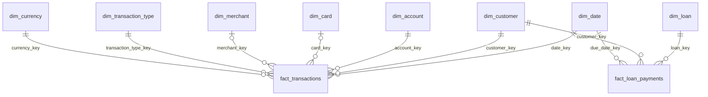

# Data model

The warehouse is a star schema defined in `sql/warehouse/01_schema.sql`, shared
by DuckDB and PostgreSQL. Money is always `BIGINT` minor units (cents) and
exchange rates `BIGINT` micros (rate × 1,000,000); see
[ADR 0007](../adr/0007-financial-amount-representation.md).



## Grain of every table

| Table | Grain | Keys |
|---|---|---|
| `fact_transactions` | one row per `transaction_id`, holding its latest known state | PK `transaction_id` (natural key; facts get no surrogate because nothing references them) |
| `fact_loan_payments` | one row per loan installment (`payment_id`) | PK `payment_id` |
| `fact_data_quality` | one row per batch × entity × rule (latest evaluation) | PK (`batch_id`, `entity`, `rule_name`) |
| `fact_pipeline_execution` | one row per step attempt (failures included) | surrogate `execution_id` |
| `dim_customer` | one row per customer **version** (SCD Type 2) | surrogate `customer_key`; unique (`customer_id`, `valid_from`) |
| `dim_account`, `dim_card`, `dim_merchant`, `dim_loan` | one row per entity (SCD Type 1) | surrogate key + unique natural key |
| `dim_date` | one row per day, 2024-01-01 … 2027-12-31 | `date_key` = YYYYMMDD |
| `dim_currency`, `dim_transaction_type` | one row per code (static, seeded by DDL) | small integer keys |
| `ref_exchange_rate` | one rate per foreign currency per day | PK (`currency_code`, `rate_date`) |
| `etl_batch` | one row per batch (furthest committed status) | PK `batch_id` |
| `etl_watermark` | one high-water mark per pipeline × entity | PK (`pipeline`, `entity`) |

### Why surrogate keys on dimensions

`dim_customer` needs one because a customer has several versions; a natural key
cannot identify a version. The SCD1 dimensions use them for consistency and
because integer joins are cheaper than string joins. The trade-off is a lookup
during the fact load (done in SQL, in `20_load_fact_transactions.sql`).

## Slowly Changing Dimension Type 2: `dim_customer`

`sql/warehouse/12_load_customers_scd2.sql`:

1. Compare each incoming customer's `attributes_hash` (computed in Silver from
   name, email, city, state and segment) with the current version.
2. If it changed, close the current version: `valid_to = updated_at`, `is_current = FALSE`.
3. Insert a new current version for new customers and for those just closed.
   The **first** version starts at `1900-01-01` so it covers every historical fact.

Facts resolve the customer *point in time*:

```sql
JOIN dim_customer c
  ON c.customer_id = s.customer_id
 AND s.event_ts >= c.valid_from
 AND (c.valid_to IS NULL OR s.event_ts < c.valid_to)
```

So a transaction from before a customer moved to PREMIUM stays attributed to
the RETAIL version. The integration test
`test_facts_point_to_the_customer_version_valid_at_event_time` checks this.

**Known limitation:** a change that arrives *older* than the current version's
`valid_from` is ignored rather than inserted into the past. Handling
out-of-order SCD2 changes requires splitting an existing version; it is listed
in the [roadmap](../roadmap.md).

## Constraints

- Primary, unique and foreign keys on every table (both engines).
- `CHECK` constraints: positive amounts, valid statuses, and
  `principal_minor + interest_minor = amount_paid_minor` on loan payments.
- PostgreSQL only: a partial unique index guarantees one current version per
  customer (`01_schema.postgres.sql`). DuckDB has no partial indexes; the load
  SQL guarantees it there and an integration test checks it.

## Indexes

`fact_transactions(date_key)`, `fact_transactions(customer_key)`,
`fact_loan_payments(due_date_key)`, `dim_customer(customer_id)` on both
engines; `fact_transactions(account_key, event_ts)` on PostgreSQL. At a few
thousand rows they barely matter (see [performance.md](../performance.md));
they document the access paths the marts and examples use.

## Data marts (`sql/marts/`)

Rebuilt in full on every run (`DROP TABLE` + `CREATE TABLE AS`): at this size a
rebuild takes milliseconds and cannot drift. `sql/staging/` shows the
incremental alternative.

| Mart | Answers |
|---|---|
| `mart_daily_transactions` | daily volume, value, failure rate, late arrivals |
| `mart_category_volume` | purchase value by merchant category, ranked |
| `mart_currency_distribution` | transactions and value by currency |
| `mart_customer_activity` | most active customers (current attributes, historical facts) |
| `mart_loan_repayments` | installments due, paid, late and missed per month |
| `mart_data_quality_rules`, `mart_batch_quality` | which rules fail most; rejection per batch |
| `mart_pipeline_performance` | step durations and failures |
| `mart_risk_flags` | transactions flagged by the simulated rules |
| `mart_elt_daily_summary` | the ELT path's answer to the daily question, for reconciliation |
