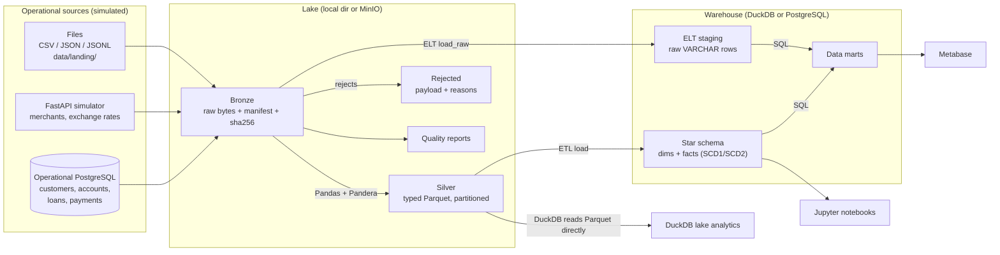

# Architecture overview

FinFlow moves synthetic financial data from three kinds of operational sources
through a layered lake (Bronze → Silver) into a dimensional warehouse (Gold),
and then into data marts, dashboards and notebooks. It is a local, small-data
proof of concept: the point is the engineering, not the volume.

## Execution profiles

The same Python package runs in three profiles. Only the adapters change.

| Profile | Lake | Warehouse | Sources | Orchestration | Needs Docker |
|---|---|---|---|---|---|
| **Lightweight** (default) | local directory `data/lake/` | DuckDB file | files only | `finflow` CLI | no |
| **Data engineering** | MinIO (S3 API) | PostgreSQL 17 | files + FastAPI + operational PostgreSQL | `finflow` CLI | yes (`make up-data`) |
| **Full platform** | MinIO | PostgreSQL 17 | same as above | Airflow 3 + CLI | yes (`make up-full`) |

Adapter selection happens in exactly three places:

- `finflow.common.storage.LakeStorage.from_settings` — `pyarrow.fs.LocalFileSystem` or `S3FileSystem` pointed at MinIO.
- `finflow.warehouse.base.connect_warehouse` — `DuckDBWarehouse` or `PostgresWarehouse`.
- `finflow.orchestration.pipeline.build_sources` — which source adapter extracts which entity.

## Components

## Package layout

| Module | Responsibility |
|---|---|
| `finflow.common` | configuration, logging, money arithmetic, lake storage, exceptions |
| `finflow.generators` | deterministic synthetic data and error injection |
| `finflow.sources` | file source, FastAPI simulator + client, operational DB source |
| `finflow.ingestion` | Bronze: write-once raw storage, manifests, replay |
| `finflow.validation` | data contracts, Pandera schemas, quality evaluation and gate |
| `finflow.transformations` | Bronze → Silver transformation, simulated risk rules |
| `finflow.warehouse` | DuckDB/PostgreSQL adapters, ELT path |
| `finflow.orchestration` | ETL steps, batch tracking, watermarks, step metrics |
| `finflow.analytics` | DuckDB-on-Parquet queries, benchmarks, SQL example runner |
| `finflow.cli` | the `finflow` command (the only entry point the Makefile and Airflow use) |

`finflow.analytics` is not in the suggested layout of the original brief. It was
added because DuckDB lake queries, benchmarks and the SQL example runner are
consumers of the platform, not part of any pipeline layer.

## Design principles applied

- **Steps communicate through storage, never memory.** Ingest writes Bronze,
  transform reads Bronze and writes Silver, load reads Silver. Any step can be
  retried or replayed on its own, which is what Airflow tasks rely on.
- **One code path, several adapters.** No profile has its own pipeline.
- **The warehouse SQL is shared.** DuckDB and PostgreSQL run the same files;
  engine-specific statements live in `*.postgres.sql` siblings (see
  [ADR 0001](../adr/0001-postgresql-warehouse-duckdb-lightweight.md)).
- **Nothing disappears silently.** Every input record is accepted, rejected
  or marked duplicate, and the counts must reconcile.

See [data-flow.md](data-flow.md) for a record's journey and
[data-model.md](data-model.md) for the star schema.
